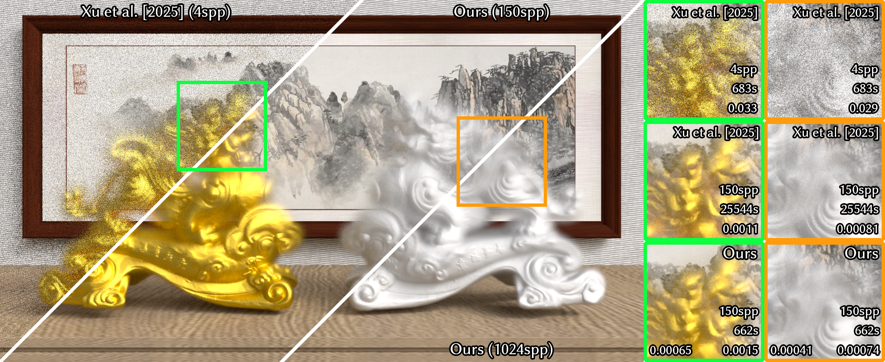

# Macrofacet Theory for Gaussian Process Statistical Surfaces



This repository contains the PBRT-based offline implementation for:

> **Macrofacet Theory for Gaussian Process Statistical Surfaces**\
> Minghao Huang, Yuang Cui, Beibei Wang, Lingqi Yan\
> ACM Transactions on Graphics (Proceedings of SIGGRAPH Asia 2026), 45(6), 2026

## Build

Please refer to [PBRT's README](README_PBRT.md).

## Usage

Our participating media are named as:

* `spheremacrofacet`: For the sphere model.

* `macrofacetvdb`: For any models described in [NanoVDB](https://developer.nvidia.com/nanovdb) format.

## Citation

If you find our work helpful, please consider citing:

```bibtex
@article{huang2026macrofacet,
author = {Huang, Minghao and Cui, Yuang and Wang, Beibei and Yan, Lingqi},
title = {Macrofacet Theory for Gaussian Process Statistical Surfaces},
year = {2026},
issue_date = {December 2026},
publisher = {Association for Computing Machinery},
address = {New York, NY, USA},
volume = {45},
number = {6},
issn = {0730-0301},
url = {https://doi.org/10.1145/3842571},
doi = {10.1145/3842571},
journal = {ACM Trans. Graph.},
month = nov,
articleno = {259},
numpages = {15},
keywords = {volumetric light transport, stochastic processes, implicit surfaces, microfacet theory, microflake theory}
}
```